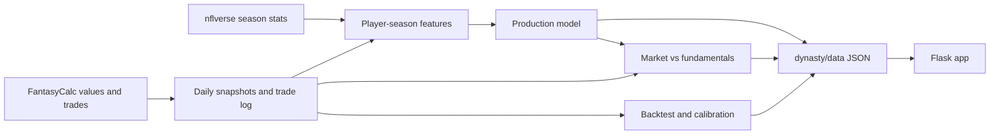

# Dynasty Trade Analyzer

A small web app that prices dynasty fantasy football trades with market data and finds balanced trades in your Sleeper league.

There is **no database and no user accounts**. League data comes live from the Sleeper API, trade values come from the public FantasyCalc API, and everything is cached in memory (with a JSON file on disk as a safety net). Restarting the app loses nothing important.

## What it does

- **Trade calculator**: enter players and draft picks for each side (for example `Ja'Marr Chase` and `2027 1st`) and get a fairness score, a verdict, and assets that could balance the deal. Works without a league.
- **Trade suggestions**: connect a Sleeper league, pick your team, choose a strategy (contending, rebuilding, balanced), how even trades must be, and positions you need. The app searches every roster for 1-for-1, 2-for-1, and 1-for-2 trades that fit.
- **League aware**: values are adjusted for Superflex vs 1 QB, PPR scoring, league size, and tight end premium. Draft pick ownership (including traded picks) comes from Sleeper.
- **Data science layer**: aging curves from NFL history, a next-season production model, a market-vs-fundamentals "buy low / sell high" signal, a roster-need and value-over-replacement model, and trade heuristics calibrated on real accepted trades. See [Data science](#data-science).
- **Calculator extras**: player autocomplete, trade history saved in your browser, and signed share links (nothing is stored on the server).
- **Optional AI explanations**: if you set `OPENAI_API_KEY`, a model writes short explanations of results. It never sets values, picks players, or scores fairness. Without a key, built-in text is used.

## How trade values work

Values come from [FantasyCalc](https://www.fantasycalc.com), whose numbers are derived from real dynasty trades and updated regularly. For every asset the app has:

- a dynasty value for the league format,
- a redraft value (used to judge "win now" fit),
- age, position, team, and rank.

Fairness is computed in plain Python:

1. For each side, sort assets by value and apply a depth discount (each extra asset counts `DEPTH_DECAY` times the previous one) because two mid-tier assets rarely equal one star. The constant is **calibrated on real trades** (see below), not guessed. It lives in `dynasty/trades.py` and is read from `dynasty/data/calibration.json`.
2. Fairness is `100 * smaller_total / larger_total`. Trades at or above the calibrated "even" threshold (the median fairness of real trades) read as even.
3. The side that **receives** the larger package wins.

Suggestions are found by search, then ranked:

- **Contending** requires more win-now (redraft) value coming back than going out.
- **Rebuilding** requires more expected 3-year production coming back (from empirical aging curves) or draft capital.
- **Balanced** scores both.
- Stated position needs add to a trade's score.
- **Roster fit**: the need model checks whether the trade fills a hole in your lineup and whether the partner is thin at what you send.
- **Projection model edge**: assets the model thinks are underpriced relative to similar profiles score higher.
- Each trade is limited to one reuse of any partner asset and two uses of any of yours, with at most two trades per partner.

## Data science

Everything below lives in `datascience/` and runs offline. The web app never imports pandas or scikit-learn; it loads small JSON artifacts from `dynasty/data/`.



### Reproduce

```bash
pip install -r requirements-ds.txt          # or requirements-ds.lock for exact versions
python -m datascience.run_all               # collect data, fit models, write dynasty/data/*.json and figures
python notebooks/build_notebooks.py         # re-execute the analysis notebooks
python -m datascience.collect snapshots     # run daily (cron) so value history and the forward test accumulate
python -m datascience.collect trades        # the trade feed only returns the latest ~50 per query; run regularly
```

Raw data goes to `data/` (gitignored). Artifacts are committed so the app works without running the pipeline.

### What each piece does

| Piece | Method | Where |
|-------|--------|-------|
| Aging curves | Pooled year-over-year retention of points per game by position and age, smoothed | `features.py`, `aging_curves.json` |
| Production model | Gradient-boosted regression of next-season PPR points with 20/80 quantile bands, evaluated walk-forward against persistence and age-curve baselines | `model.py` |
| Market vs fundamentals | Out-of-fold model of market value from projected points, age, experience, draft capital; the residual is the buy/sell edge | `model.py`, `model_edges.json` |
| Depth discount | Grid search over real accepted trades minimizing squared log imbalance, with bootstrap intervals | `backtest.py`, `calibration.json` |
| Position adjustments | Ridge regression on position value shares, applied only if the 90% bootstrap interval excludes zero | `backtest.py` |
| TE premium | Receptions per point of starting TEs gives a relative TE value multiplier | `features.py` |
| Bench values | The market-pricing model applied to unpriced players, capped below the cheapest market asset | `model.py` |
| Roster needs and VORP | Greedy starting lineups, league-wide replacement level, need and surplus by position | `dynasty/needs.py` |
| Forward test | Does the heuristic's winning side gain more market value later? Activates once snapshots span a week | `backtest.py` |

Notebooks in `notebooks/` walk through the analysis with outputs saved; charts are in `notebooks/figures/`.

### Results at the last run (October 2026)

- **Production model**: mean absolute error about 42 points vs 47 for "next year equals this year" and 46 for the age-curve baseline, with rank correlation 0.71 vs 0.68 (7 walk-forward seasons). An honest, modest gain: next-season production is mostly noise. The 20/80 band covers about 77% of outcomes (a calibrated band would cover 60%), so the bands are conservative.
- **Depth discount**: the best fit on 280 real trades is about 0.65 (90% bootstrap interval 0.58 to 0.71). The earlier hand-picked 0.92 fit worse than 0.65 and better than no discount, and the loss curve is flat between 0.6 and 0.7.
- **Real trades are not perfectly even**: the median accepted trade scores about 82% on this fairness measure, so the "even" threshold is set there instead of at 90.
- **Market vs fundamentals** explains about half the variance of log market value out of sample, so edges are noisy and flagged only beyond 1.25 standard deviations.

### Limitations

- Trades are valued with current market values (they are recent, so drift is small). Accepted trades are not proven fair, and the sample is only what the collector has gathered.
- The edge signal compares against production-based expectations. Injured players, role changes, and rookies without NFL history are misjudged or not scored. Treat it as a prompt to look closer, not advice.
- Production features come from the latest completed NFL season and PPR scoring; other formats reuse the same projections.
- Position multipliers and the depth discount are fit to the trades available today and will move as more are collected. Re-run `python -m datascience.run_all` periodically.
- Check FantasyCalc's, Sleeper's, and nflverse's terms before commercial use, and keep the credit in the footer.

## Quick start

Requires Python 3.9 or newer (3.11 or newer for the data science pipeline).

```bash
git clone <your-repo-url>
cd Fantasy-Dynasty-Trade-Calculator
python3 -m venv .venv
source .venv/bin/activate
pip install -r requirements-dev.txt
python run.py
```

Open http://127.0.0.1:5000.

Optional environment variables (see `env.example`):

```bash
export OPENAI_API_KEY='sk-...'   # AI-written explanations
export SECRET_KEY='...'          # required when APP_ENV=production
```

Run the tests and linters:

```bash
pytest                      # data science tests skip themselves unless requirements-ds.txt is installed
ruff check . && mypy dynasty
```

For reproducible installs use `pip install -r requirements.lock` (web app) or `requirements-ds.lock` (everything). Regenerate with `uv pip compile requirements.txt -o requirements.lock --python-version 3.9 --universal`.

To sanity-check against your own league from the command line:

```bash
python scripts/verify_league.py <league_id> <sleeper_username>
```

## Configuration

| Variable | Default | Purpose |
|----------|---------|---------|
| `APP_ENV` | `development` | `production` requires `SECRET_KEY`, enables secure cookies, trusts proxy headers |
| `SECRET_KEY` | random per process in dev | Signs the session cookie |
| `OPENAI_API_KEY` | unset | Enables AI explanations |
| `OPENAI_MODEL` | `gpt-4o-mini` | Model used for explanations |
| `LLM_CALLS_PER_HOUR` | `20` | Per-client cap on AI calls (falls back to built-in text) |
| `REQUESTS_PER_MINUTE` | `60` | Per-client cap on form submissions |
| `VALUES_CACHE_SECONDS` | `21600` | How long FantasyCalc values are cached in memory |
| `LEAGUE_CACHE_SECONDS` | `300` | How long Sleeper league data is cached |
| `CACHE_DIR` | `./.cache` | Where the on-disk copy of values is kept (safe to delete) |
| `TRUST_PROXY` | on in production | Use `X-Forwarded-*` headers so rate limits see real client IPs |

## Where state lives

| Data | Location |
|------|----------|
| League, rosters, traded picks | Fetched from Sleeper, cached in memory for 5 minutes |
| Trade values | Fetched from FantasyCalc, cached in memory for 6 hours, mirrored to `.cache/*.json` |
| Selected league and team | Signed session cookie (IDs and display names only) |
| Rate limit counters | In memory, per process |

With more than one worker the caches and counters are per worker. That is fine for caches, and it means rate limits are approximate.

## Project layout

```
dynasty/
  __init__.py      app factory, security headers, error handlers, CSRF
  config.py        environment-based configuration
  sleeper.py       Sleeper API client and league model
  values.py        FantasyCalc client, name and pick matching, disk cache
  trades.py        fairness math and trade search
  needs.py         roster-need, replacement level, and VORP model
  insights.py      loads data science artifacts (stdlib only, safe defaults)
  data/            artifacts written by the pipeline (calibration, edges, aging curves, history)
  llm.py           optional OpenAI explanations (never sets values)
  cache.py         TTL cache and rate limiter
  routes.py        pages
  templates/       Jinja templates
  static/          CSS and calculator.js (autocomplete, history)
datascience/       offline pipeline: collect, features, model, backtest, figures
notebooks/         executed analysis notebooks and figures
scripts/           verify_league.py
tests/             pytest suite (no network needed)
wsgi.py            production entry point (gunicorn wsgi:app)
run.py             local development entry point
```

## Deployment

Deploy as a single web service. No database or other service is needed. See [DEPLOYMENT.md](DEPLOYMENT.md).

## Troubleshooting

- **"Trade values are temporarily unavailable"**: FantasyCalc could not be reached and no cached copy exists yet. Try again shortly; once fetched, values survive outages.
- **"No Sleeper league was found"**: use the numeric ID from the league URL on Sleeper, not the league name.
- **A player is not found in the calculator**: names must match FantasyCalc spellings (punctuation, accents, and Jr/Sr suffixes are ignored). Picks use `2027 1st`; only 2027 to 2029 are priced.
- **Everything resets after a restart in development**: without `SECRET_KEY` a new key is generated each run, which signs you out. Set one to stay signed in.

## Operations notes

- **Logging**: every request logs `rid=<request id> METHOD path -> status ms`, and the same ID is returned in the `X-Request-ID` response header (a client-supplied one is honored if it is alphanumeric). Point your host's log drain at stdout.
- **Rate limits** are per process. If you run several instances and need strict limits, enforce them at the proxy or CDN rather than adding a database.
- **Second value source**: FantasyCalc is the only source. If it changes its API, cached values keep working and the app degrades with a clear message. A fallback such as KeepTradeCut was deliberately not added because its terms have not been reviewed.
- **Privacy**: see the in-app `/privacy` page. League IDs go to Sleeper; if `OPENAI_API_KEY` is set, trade details go to OpenAI.
- Licensed under the MIT License (see `LICENSE`). Review the API terms of FantasyCalc, Sleeper, and nflverse before any commercial use.
